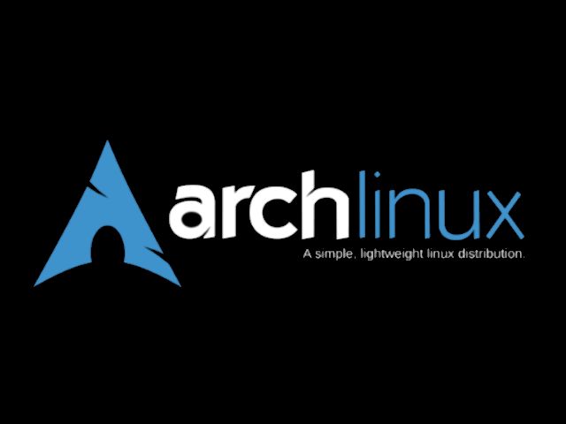

# ⚡ GA36 Clone PC Cyber Dashboard & Live Hardware Monitor

[](LICENSE)
[](https://kernel.org)
[]()
[-purple.svg)]()
[](https://github.com/Auxerov/Dashboard-Image-for-GA36-Clone/releases)

> Turn your **GA36 Clone** (Allwinner A33 / EmuELEC 4.7 handheld console) into a dedicated, ultra-smooth **PC Cyber Hardware Dashboard** over a single USB-C cable!

---

## 📸 Screenshots & Previews

| Cyber Boot Splash | Giant 4-Pie HUD (Default) | Dual Ring HUD | Cyber 'btop' HUD |
|:---:|:---:|:---:|:---:|
|  |  |  |  |

---

## ✨ Features

- **Giant 4-Dial Ring HUD (640x480 Fullscreen):** High-contrast circular meters for CPU, GPU, RAM, and Network (Download/Upload) with large, crisp readouts visible across the desk.
- **Animated GIF & Image Gallery Mode:** Stream smooth animated GIFs and static wallpapers directly to your console screen with real-time frame looping and aspect ratio preservation. Save your favorites to `~/Pictures/GA36_Gallery` and browse using the console D-Pad!
- **Zero-Flicker & Direct Framebuffer Boot:** EmulationStation is masked out and the Linux hardware framebuffer (`/dev/fb0`) is allocated directly to the PC companion stream. No UI stutter, no screen flashing, and no audio crackle.
- **Silent & Clean (Zero Audio Overhead):** Pulseaudio and all background sound daemons are completely disabled and masked; audio files have been stripped for maximum power efficiency and zero speaker hiss.
- **Physical Gamepad Controls:**
  - `[ A ]`: Media Play / Pause (Spotify, YouTube, VLC via MPRIS D-Bus)
  - `[ B ]`: Next Track
  - `[ X ]`: Toggle PC Microphone Mute (via WirePlumber / wpctl)
  - `[ Y ]`: Capture PC Screenshot (Spectacle / custom tool)
  - `[ SELECT / MODE / START / FN ]`: Cycle HUD Themes (`PIE` ➔ `DUAL` ➔ `BTOP` ➔ `GALLERY`)
  - `[ DPAD LEFT / UP ]`: Previous image or animated GIF in Gallery mode
  - `[ DPAD RIGHT / DOWN ]`: Next image or animated GIF in Gallery mode
  - `[ L1 / R1 ]`: Quick HUD theme toggle
- **Smart Power & Eco Mode (~2.5 FPS):** Console CPU runs below 1.5% load, remains completely cool, and automatically charges from the host computer's USB-C port.
- **Host PC Power Synchronization:** When your computer boots, the console wakes and shows the dashboard. When the computer shuts down, the console automatically powers off cleanly.
- **100% Reversible:** Restore the original gaming menu and stock settings at any time with a single command (`./install.sh restore`).

---

## 🚀 Quick Start (PC Setup)

Install dependencies, configure udev permissions, and start the background service with a single command:

```bash
git clone https://github.com/Auxerov/Dashboard-Image-for-GA36-Clone.git
cd Dashboard-Image-for-GA36-Clone
./install.sh
```

### 🎮 Control Commands (`./install.sh`)

The `install.sh` script manages both setup and all operational commands:

| Command | Description |
| :--- | :--- |
| `./install.sh` | Installs dependencies, sets up udev rules, and starts the service |
| `./install.sh status` | Checks service status and USB connectivity |
| `./install.sh mode [pie\|dual\|btop\|gallery]` | Switches HUD mode/theme on-the-fly (live update without restart) |
| `./install.sh gallery` | Opens or displays information about `~/Pictures/GA36_Gallery` |
| `./install.sh dashboard` | Opens an interactive terminal monitor and live HUD switcher |
| `./install.sh stop` | Pauses the display stream |
| `./install.sh start` | Resumes the display stream |
| `./install.sh logs` | Follows live system logs |
| `./install.sh image <image.png>` | Sends a custom image / wallpaper directly to the console screen |
| `./install.sh battery` | Displays battery percentage, charging state, and voltage |
| `./install.sh shell` | Opens an interactive root shell (Serial/RPC) on the console |
| `./install.sh restore` | Restores console back to the original stock game menu |
| `./install.sh backup` | Creates a compressed `.img.xz` backup of the inserted SD card |
| `./install.sh uninstall` | Removes PC companion service and udev rules |

---

## 🛠️ Flashing & Installation Methods

### Method 1: Ready-to-Flash Image (Recommended)
Download the pre-built, ultra-compact image from the [Releases](https://github.com/Auxerov/Dashboard-Image-for-GA36-Clone/releases) page (`GA36_Cyber_Dashboard_OS_v1.0.img.xz`).
Flash it directly to any MicroSD card (>= 4 GB) using **BalenaEtcher**, **Raspberry Pi Imager**, or **Rufus**. Insert into the console's TF1 slot, power on, and connect to your PC.

### Method 2: Direct USB Installation to Existing Console
With your console powered on and connected to your PC via USB-C:
```bash
./scripts/deploy_to_device.sh
```
*This injects the lightweight background agent, masks EmulationStation, mutes audio hardware, and locks the console to the PC Dashboard.*

### Method 3: SD Card Overlay
Insert your SD card into your PC's card reader and run:
```bash
./scripts/flash_sdcard.sh
```
*Or extract `sdcard_overlay.tar.gz` into the root of your SD card's `STORAGE` partition.*

---

## 💾 Creating SD Card Backups (`backup_image.sh`)

To create an ultra-compressed `.img.xz` disk backup of your working SD card:
```bash
sudo ./scripts/backup_image.sh
```
The script auto-detects the connected SD card, skips unallocated space, and outputs a ready-to-flash image into the `backups/` directory.

---

## ⚠️ Important Technical Note: GA36 Clone vs. ArkOS Handhelds

Standard R36S handhelds use the **Rockchip RK3326** SoC, whereas GA36 clones are powered by the **Allwinner A33 (sun8i/UDT)** architecture.
- Flashing a standard R36S ArkOS image onto a GA36 clone will result in a **black screen and failure to boot**.
- This repository specifically targets Allwinner A33 GA36 clones with optimized Linux Framebuffer (`/dev/fb0`) rendering and CDC-ACM USB serial gadget communication.

---

## 📄 License

This project is licensed under the [GNU General Public License v3.0](LICENSE).
