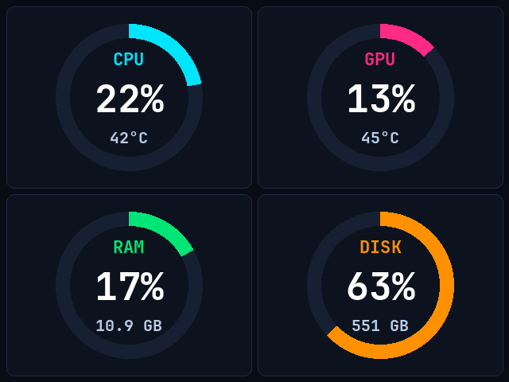
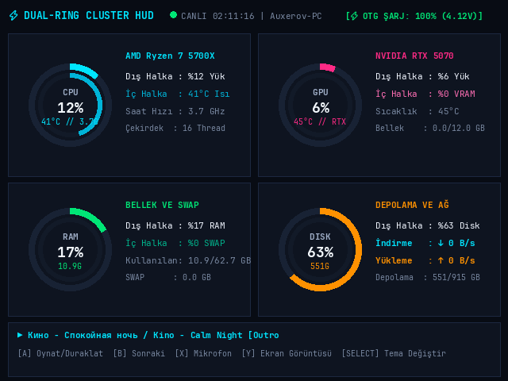
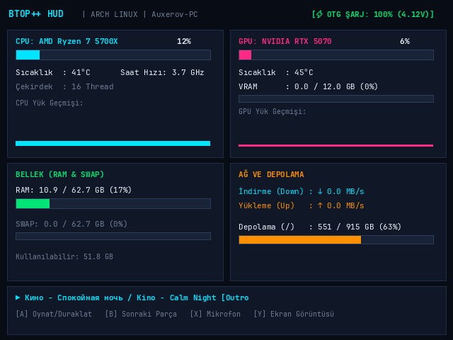

# ⚡ GA36 Clone PC Cyber Dashboard & Live Hardware Monitor

[](LICENSE)
[](https://kernel.org)
[]()
[-purple.svg)]()

> Turn your **GA36 Clone** (Allwinner A33 / EmuELEC 4.7 handheld console) into a dedicated, ultra-smooth **PC Cyber Hardware Dashboard** over a single USB-C cable!

---

## 📸 Ekran Görüntüleri / Screenshots

| 4 Dev Halka / Giant 4-Pie HUD (Varsayılan) | Çift Halka / Dual Ring HUD | Cyber 'btop' HUD |
|:---:|:---:|:---:|
|  |  |  |

---

## ✨ Özellikler / Features

- **Dev 4-Kadran Halka HUD (640x480 Tam Ekran):** CPU, GPU, RAM ve Ağ (Download/Upload) metrikleri ekranı kaplayan 92px çapında devasa halkalar ve 48pt kalın beyaz yazılarla gösterilir.
- **Sıfır Titreme & Doğrudan Açılış:** EmulationStation arka planda maskelenerek donanım ekran belleği (`/dev/fb0`) doğrudan PC monitörüne tahsis edilir. Ekran titremesi ("git-gel") ve ses takılmaları %100 engellenmiştir.
- **Fiziksel Gamepad Kontrolleri:**
  - `[ A ]`: Medya Oynat / Duraklat (Spotify, YouTube, VLC)
  - `[ B ]`: Sonraki Şarkı
  - `[ X ]`: PC Mikrofonunu Sustur / Aç (Mute)
  - `[ Y ]`: Ekran Görüntüsü Al (PC Screenshot)
  - `[ SELECT ]`: HUD Temalarını Döndür (`PIE` ➔ `DUAL` ➔ `BTOP`)
- **Akıllı Güç & Eko-Mod (~2.5 FPS):** Konsol işlemcisi <%1.5 yük altında çalışır, ısınmaz ve bilgisayarın USB portundan sürekli şarj olur.
- **PC ile Senkronize Çalışma:** Bilgisayar açıldığında konsol otomatik uyanır ve paneli gösterir; bilgisayar kapandığında konsol da otomatik olarak kapanır.
- **%100 Geri Döndürülebilir:** Tek bir komutla (`./install.sh restore`) dilediğiniz zaman konsolu fabrika ayarlarına ve oyun menüsüne geri döndürebilirsiniz.

---

## 🚀 Hızlı Başlangıç (PC Kurulumu)

Tek bir shell komutu ile bağımlılıkları yükleyin, udev izinlerini yapılandırın ve arka plan servisini başlatın:

```bash
git clone https://github.com/Auxerov/Dashboard-Image-for-GA36-Clone.git
cd Dashboard-Image-for-GA36-Clone
./install.sh
```

### 🎮 Kontrol Komutları (`./install.sh`)

Script hem kurulum hem de tüm yönetim işlemlerini tek noktadan yürütür:

| Komut | Açıklama |
| :--- | :--- |
| `./install.sh` | Bağımlılıkları kurar, udev kuralını ekler ve servisi başlatır |
| `./install.sh status` | Servis durumunu ve USB bağlantısını kontrol eder |
| `./install.sh dashboard` | Canlı terminal ekranı ve tema değiştiriciyi açar |
| `./install.sh stop` | Ekran akışını duraklatır |
| `./install.sh start` | Ekran akışını yeniden başlatır |
| `./install.sh logs` | Sistem loglarını canlı takip eder |
| `./install.sh image <resim.png>` | Konsol ekranına özel resim / duvar kağıdı basar |
| `./install.sh battery` | Şarj yüzdesi ve voltaj durumunu gösterir |
| `./install.sh shell` | Konsola tam yetkili canlı root terminali (SSH/Serial) açar |
| `./install.sh restore` | Konsolu eski haline (oyun menüsüne) geri yükler |
| `./install.sh backup` | Takılı SD kartın tam `.img.xz` yedeğini alır |
| `./install.sh uninstall` | PC servis ve udev kurallarını temizler |

---

## 🛠️ Konsolu Dashboard Moduna Geçirme

### Yöntem 1: USB Üzerinden Doğrudan Kurulum (Önerilen)
Konsolunuz açıkken ve USB kablosuyla PC'ye bağlıyken:
```bash
./scripts/deploy_to_device.sh
```
*Bu işlem konsolun içine gerekli boot servislerini yükler, EmulationStation'ı maskeler ve doğrudan Dashboard ekranına kilitler.*

### Yöntem 2: SD Kartı Bilgisayara Takarak Kurulum
SD kartınızı bilgisayarınızın kart okuyucusuna takın ve çalıştırın:
```bash
./scripts/flash_sdcard.sh
```
*Veya `sdcard_overlay.tar.gz` arşivini SD kartınızın `STORAGE` bölümünün kök dizinine çıkartın.*

### Yöntem 3: Hazır İmajı Yazdırma (Full Flashable Image)
[Releases](https://github.com/Auxerov/Dashboard-Image-for-GA36-Clone/releases) sayfasından indirilen `.img.xz` imaj dosyasını **BalenaEtcher** veya **Raspberry Pi Imager** ile doğrudan SD karta yazdırabilirsiniz.

---

## 💾 SD Kart Tam İmaj Yedeği Alma (`backup_image.sh`)

Mevcut çalışan SD kartınızın tam disk imajını sıkıştırılmış `.img.xz` olarak almak için:
```bash
sudo ./scripts/backup_image.sh
```
Betik takılı SD kartı tespit eder, boş alanları göz ardı ederek ultra sıkıştırma (XZ) uygular ve `backups/` klasörüne hazır imaj dosyası üretir.

---

## ⚠️ Önemli Teknik Bilgi: GA36 Clone ve ArkOS Farkı

Standart R36S konsolları **Rockchip RK3326** işlemci kullanırken, piyasadaki GA36 klonları **Allwinner A33 (sun8i/UDT)** mimarisine sahiptir.
- Standart R36S ArkOS imajlarını bu cihaza yazarsanız cihaz **siyah ekranda kalır ve açılmaz**.
- Bu depo, Allwinner A33 tabanlı GA36 klonları için özel olarak optimize edilmiş EmuELEC çekirdeği ve Linux Framebuffer (`/dev/fb0`) sürücülerini kullanır.

---

## 📄 Lisans

Bu proje [GPLv3](LICENSE) lisansı altında sunulmaktadır.
